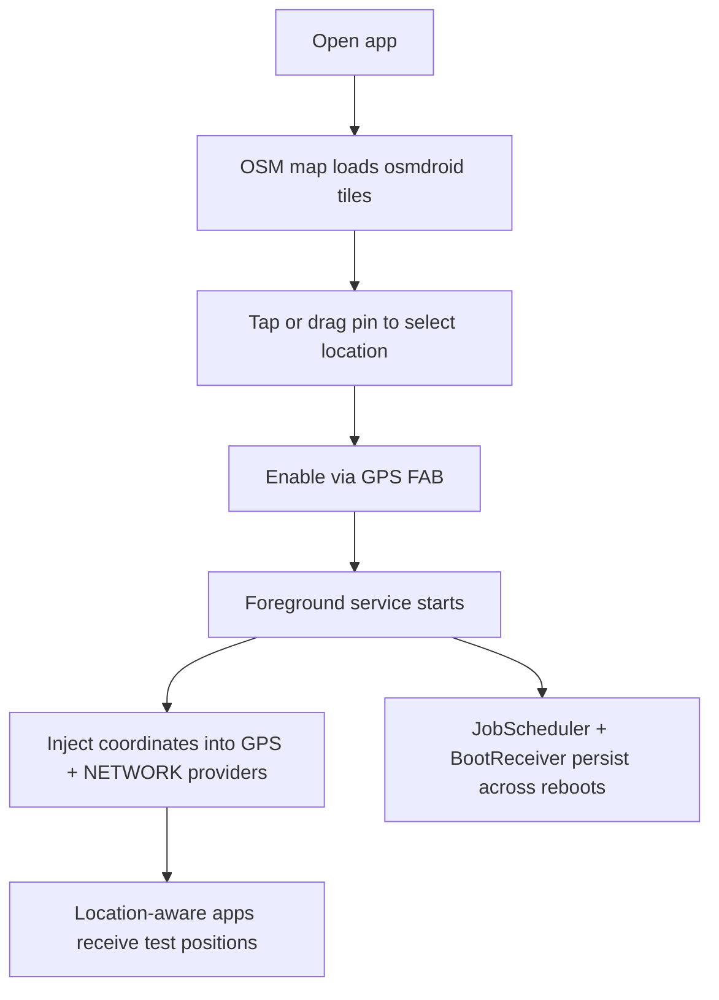
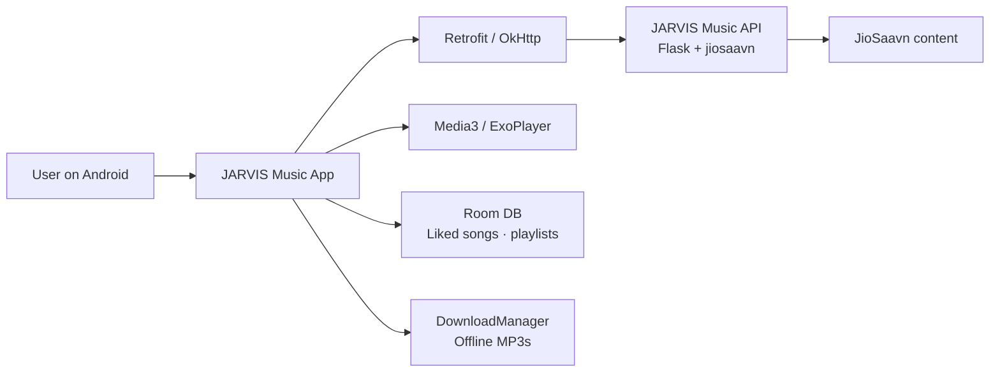
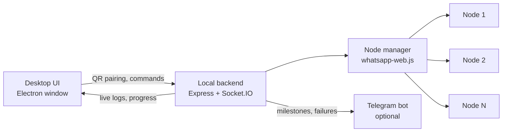

<div align="center">

# 👋 Hi, I'm CodeWithLakxsh

**Developer building the JARVIS project ecosystem — Android apps, desktop automation, and developer utilities.**


[](https://codewithlakxsh.github.io/)
[](https://github.com/CodeWithLakxsh?tab=repositories)
[](https://github.com/CodeWithLakxsh/Jarvis-GeoSpoof/releases/tag/v1.0.0)
[](https://github.com/CodeWithLakxsh)

</div>

---

## 📊 Profile Summary

| Focus | Current Ecosystem | Platforms | Types of Work |
| :---: | :---: | :---: | :---: |
| Android · Desktop · Automation | JARVIS | Android · Windows · Web | Native apps, desktop tools, web portfolios, self-hosted APIs |

---

## 👨‍💻 About Me

I'm a developer who builds **practical applications** — the kind of software that solves a real, everyday problem and ships as something usable: an APK, an installer, or a live website.

My work is organized around the **JARVIS project ecosystem**, a collection of applications and tools developed under a common identity:

- **JARVIS GeoSpoof** — a native Android developer tool for GPS location testing using Android's official mock-location APIs
- **JARVIS Music** — a Kotlin/Android music streaming and downloading app for JioSaavn content, backed by a self-hostable Flask API
- **JARVIS WhatsApp Sender** — an Electron desktop control center for multi-account WhatsApp campaign automation
- **JARVIS Portfolio** — the cyber-themed showcase website that ties the suite together

I like working across the full stack of a project: native mobile UIs with Java and Kotlin, desktop shells with Electron, local and self-hosted backends with Node.js and Python, and static sites shipped on GitHub Pages. I also document my work thoroughly — every JARVIS repository ships with a README, contributing guidelines, security policy, and issue templates.

> The JARVIS ecosystem is a personal project suite. Each application in it is independent, built around a single clear purpose: **build tools, understand the system, keep improving the implementation.**

| 🛠️ **What I build** | Android applications, desktop automation tools, developer utilities, web experiences |
|---|---|
| 🎯 **Approach** | Project-oriented, end-to-end — from UI to backend to packaging and deployment |
| 🧩 **Style** | Documented, structured, self-contained repositories |
| 🗺️ **Where my projects live** | Android · Windows desktop · GitHub Pages · self-hosted APIs |

---

## 🧰 Technical Arsenal

### 💻 Languages

<p align="left">
  
</p>

**Kotlin · Java · JavaScript · Python · HTML · CSS**

### 📱 Android Development

<p align="left">
  
</p>

**Android SDK · AndroidX · Material Components · ViewBinding · ConstraintLayout · Kotlin Coroutines · Media3 / ExoPlayer · Retrofit · OkHttp · Glide · Room (kapt) · DownloadManager · Foreground Services · JobScheduler · osmdroid / OpenStreetMap · Mock Location APIs**

### 🖥️ Desktop & Automation

<p align="left">
  
</p>

**Electron 30 · Node.js ≥ 18 · Express 4 · Socket.IO 4 · whatsapp-web.js · Puppeteer · QR authentication · NSIS packaging (electron-builder)**

### ⚙️ Backend & APIs

<p align="left">
  
</p>

**Python · Flask · `jiosaavn` · Node.js · Express · REST API design · JSON · CORS**

### 🌐 Web

<p align="left">
  
</p>

**HTML5 · CSS3 · Vanilla JavaScript · Tailwind CSS (CDN) · GitHub Pages**

### 🗄️ Data & Local Storage

**Room (SQLite, Kotlin) · SharedPreferences · JSON · `.env` configuration**

### 🔧 Build, Tooling & Deployment

<p align="left">
  
</p>

**Gradle (Kotlin DSL) · AGP 8.11 · JDK 17 · Gradle wrapper · npm · electron-builder · Git · GitHub · GitHub Pages · GitHub Releases**

---

## 🎯 Engineering Focus

| Area | What I Build | Technologies |
| :--- | :--- | :--- |
| **Android Applications** | Native utility and media apps for the JARVIS suite | Java, Kotlin, AndroidX, Material Components |
| **Desktop Applications** | Electron-based desktop control centers | Electron, Node.js, Express, Socket.IO |
| **Automation** | Multi-session messaging workflows with live monitoring | whatsapp-web.js, Puppeteer, QR pairing |
| **Media Applications** | Streaming, offline downloads, playlists, liked-song libraries | Media3/ExoPlayer, Retrofit, Room, DownloadManager |
| **API Integration** | Android apps talking to self-hosted APIs | Retrofit, OkHttp, Flask, REST |
| **Location Testing** | Developer tools for GPS mock-location testing | osmdroid, Mock Location APIs, Foreground Services |
| **Web Experiences** | Static showcase sites with zero runtime dependencies | HTML5, CSS3, Vanilla JS, GitHub Pages |

---

# ⚡ JARVIS Ecosystem

**JARVIS** is my personal project suite — a family of independent applications built under a shared identity. Each tool targets a practical workflow, and every repository is fully documented with README, contributing guidelines, security policy, and issue templates.

```
JARVIS
├── 🛰️ GeoSpoof            Android · Java      — GPS mock-location testing tool
├── 🎵 Music                Android · Kotlin    — music streaming & downloads + Flask API
├── 💬 WhatsApp Sender      Desktop · Electron  — multi-account campaign automation
└── 🌐 Portfolio            Web · HTML/CSS/JS   — the ecosystem's showcase site
```

---

## 🛰️ JARVIS GeoSpoof

**An Android developer tool for simulating GPS locations using the platform's official mock-location APIs.**

JARVIS GeoSpoof is a native Android application (Java) that lets you pick any point on an interactive OpenStreetMap and feed those coordinates to the device's **GPS** and **NETWORK** location providers through Android's documented developer APIs (`LocationManager.addTestProvider` / `setTestProviderLocation`). It is a standalone alternative to the built-in *Developer Options → Select mock location app* feature — aimed at developers and QA engineers testing location-dependent behavior without physically traveling.

The engine runs in a **foreground service** with a persistent notification and a 500 ms refresh loop, persists state in `SharedPreferences`, and re-activates itself after a device reboot via a **`BootReceiver` + `JobScheduler`** pipeline. A one-time guided setup dialog walks users through the required device configuration, including battery-optimization exemption.

> This is a development and testing utility. It relies on Android's standard mock-location mechanism, does not require root, and does not bypass any security control — mock locations remain detectable via `isFromMockProvider()`.



| **Platform** | Android 6.0+ (minSdk 23 · targetSdk 34 · compileSdk 36) |
|---|---|
| **Language** | Java |
| **Maps** | osmdroid 6.1.18 (OpenStreetMap) |
| **Key APIs** | Mock Location APIs · Foreground Service · JobScheduler · BootReceiver · SharedPreferences |
| **Build** | Gradle 8.13 · AGP 8.11.2 (Kotlin DSL) · JUnit 4 + Espresso tests |
| **Status** | Released — **v1.0.0** with prebuilt APK |
| **Security** | No credentials, no telemetry, no API keys; location stored only on-device |

[](https://github.com/CodeWithLakxsh/Jarvis-GeoSpoof)
[](https://github.com/CodeWithLakxsh/Jarvis-GeoSpoof/releases/tag/v1.0.0)

---

## 🎵 JARVIS Music

**A native Android music streaming and downloading app for JioSaavn content — with a self-hostable Flask API.**

JARVIS Music is a Kotlin Android application that delivers a full music-player experience: search and stream songs, browse curated home sections (Hindi, Punjabi, Hip-Hop, Pop, and more), manage liked songs, create playlists, and download tracks for offline playback. Playback is handled by **Media3 / ExoPlayer**, with a mini + full player, infinite queue with automatic refill, and shuffle/repeat modes.

The Android app never talks to JioSaavn directly. It calls the **JARVIS Music API** — a small Python Flask service bundled in the repository — which wraps the `jiosaavn` package and returns normalized JSON. The API is self-hostable (`python index.py` on port 5100) and reads its signing key from a `SECRET` environment variable.

> This project's README is derived from static source analysis and was not runtime-tested at publication time — the feature list below is verified directly from the source code.



| **Platform** | Android 7.0+ (minSdk 24 · targetSdk 35 · compileSdk 35) |
|---|---|
| **Language** | Kotlin |
| **Networking** | Retrofit 2.9 + Gson · OkHttp 4.12 |
| **Media** | Media3 / ExoPlayer 1.2 (exoplayer, ui, common) |
| **Storage** | Room 2.6.1 · SharedPreferences |
| **Backend** | Python Flask + `jiosaavn` (self-hostable, CORS, SECRET key) |
| **Build** | Gradle 8.13 · AGP 8.11.2 · Kotlin 2.0.21 · kapt · JDK 17 |
| **Status** | In active development |

[](https://github.com/CodeWithLakxsh/Jarvis-Music)

---

## 💬 JARVIS WhatsApp Sender

**An Electron desktop control center for orchestrating multi-account WhatsApp message campaigns.**

JARVIS WhatsApp Sender is a desktop application (Electron 30 + Node.js ≥ 18) that solves a genuinely awkward problem: operating WhatsApp messaging across multiple accounts without opening a browser tab per account. WhatsApp accounts are paired as **nodes** via QR-code scans (`whatsapp-web.js` + Puppeteer sessions), and a local Express + Socket.IO backend streams live progress to a terminal-style UI built with Tailwind CSS.

Campaigns are driven by CSV contact imports with `{FirstName}` template personalization, optional media attachments, rotating proxy injection, and per-number verification before sending. Campaigns can be paused, resumed, or stopped mid-flight, and an optional Telegram bot streams milestones, node failures, and completions. The app ships with session persistence and a one-command Windows NSIS installer built with electron-builder.

> Responsible use: this project automates bulk messaging on WhatsApp, which may violate WhatsApp's Terms of Service and spam laws in your jurisdiction. Use it only for consent-based outreach and accept full responsibility for the accounts you connect.



| **Platform** | Windows desktop (NSIS installer) · dev on any OS |
|---|---|
| **Runtime** | Node.js ≥ 18 |
| **Desktop shell** | Electron 30 · electron-builder 24 |
| **Backend** | Express 4 · Socket.IO 4 |
| **Automation** | whatsapp-web.js ^1.23 · Puppeteer · qrcode |
| **Frontend** | HTML + vanilla JS · Tailwind CSS (CDN) |
| **Status** | Documented · maintained |

[](https://github.com/CodeWithLakxsh/Jarvis-Whatsapp-Sender)

---

## 🌐 JARVIS Portfolio

**The web showcase for the JARVIS ecosystem — a cyber-themed, fully static single-page site.**

The portfolio site presents the JARVIS suite with a boot-up loader animation, particle canvas and aurora background, 3D tilt interaction on download cards, and an interactive download hub for the suite's apps. It is built with plain HTML5, CSS3, and vanilla JavaScript — no build step, no runtime dependencies — and deployed automatically on GitHub Pages from the `main` branch.

| **Stack** | HTML5 · CSS3 · Vanilla JS · Font Awesome 6 · Google Fonts (Space Grotesk, JetBrains Mono, Syne) |
|---|---|
| **Hosting** | GitHub Pages (static, from `main`) |
| **Status** | Live |

[](https://github.com/CodeWithLakxsh/CodeWithLakxsh.github.io)
[](https://codewithlakxsh.github.io/)

---

## 🔧 Forks & Contributions

These repositories are **forks**, not original projects — kept separate from the JARVIS suite:

- **JioSaavnAPI** — personal fork of [cyberboysumanjay/JioSaavnAPI](https://github.com/cyberboysumanjay/JioSaavnAPI) (Python 3 music API). My fork currently sits **3 commits ahead of upstream**, containing a query-handling logic fix, a search/error-handling refactor, and deployment configuration. [Fork](https://github.com/CodeWithLakxsh/JioSaavnAPI)
- **register** — fork of the [is-a.dev](https://is-a.dev) subdomain registry, used for contribution workflow (pending `laksh.is-a.dev` registration PR). [Fork](https://github.com/CodeWithLakxsh/register)

---

## 🧠 What I Build

```
Android
├── 🛰️ JARVIS GeoSpoof          — GPS mock-location testing tool (Java)
└── 🎵 JARVIS Music              — music streaming & downloading app (Kotlin)

Desktop
└── 💬 JARVIS WhatsApp Sender    — Electron campaign automation console

Web
└── 🌐 JARVIS Portfolio          — static showcase site on GitHub Pages

Backend / API
├── 🐍 Flask + jiosaavn          — self-hostable JARVIS Music API
└── 🟢 Express + Socket.IO       — local backend for the WhatsApp Sender
```

---

## 🧩 Engineering Concepts in My Projects

Extracted from the actual source of the JARVIS repositories:

| Concept | Where it appears |
| :--- | :--- |
| Android foreground services + persistent notifications | GeoSpoof (`JarvisSpoofService`) |
| Android mock-location providers (`addTestProvider`, `setTestProviderLocation`) | GeoSpoof |
| Boot persistence via `BootReceiver` + `JobScheduler` | GeoSpoof |
| Map rendering with osmdroid / OpenStreetMap tiles | GeoSpoof |
| Media playback with Media3 / ExoPlayer | Music |
| Local persistence with Room (entities, DAOs, kapt) | Music |
| REST API consumption with Retrofit + OkHttp + Gson | Music |
| Offline downloads via Android `DownloadManager` | Music |
| Self-hostable backend APIs (Flask, CORS, env-based secrets) | Music API |
| Real-time client-server communication with Socket.IO | WhatsApp Sender |
| Electron application architecture (main process, local server, UI) | WhatsApp Sender |
| QR-code session authentication with `whatsapp-web.js` | WhatsApp Sender |
| Static-site deployment on GitHub Pages | Portfolio |
| Gradle Kotlin DSL builds + version catalogs | GeoSpoof, Music |

---

## 📊 GitHub Dashboard

<div align="center">

<picture>
  <source media="(prefers-color-scheme: dark)" srcset="https://streak-stats.demolab.com/?user=CodeWithLakxsh&theme=github-dark-blue&hide_border=true" />
  
</picture>

<picture>
  <source media="(prefers-color-scheme: dark)" srcset="https://github-readme-activity-graph.vercel.app/graph?username=CodeWithLakxsh&theme=github-dark&hide_border=true&area=true&radius=8" />
  
</picture>

</div>

> The `github-readme-stats` service is currently returning 503, so the stats and top-languages cards are intentionally omitted rather than showing broken placeholders.

---

## 🔨 Currently Building

The most recent activity in the JARVIS suite:

- **JARVIS GeoSpoof** — released **v1.0.0** (first tagged release with a prebuilt APK)
- **JARVIS Music** — the newest repository; Android app and Flask API in active development
- **JARVIS ecosystem** — continuing to evolve the suite and its showcase site

---

## 🧠 Currently Exploring

Inferred from the direction of the active repositories (not claimed beyond what the code shows):

- Deeper Android development — Kotlin, application architecture, lifecycle-aware components
- Media application design — playback, queues, and offline storage
- Self-hosted API design — Flask services and consuming them from native clients
- Automation engineering — session management and real-time monitoring

---

## 🚀 Development Landscape

A conceptual map of how the JARVIS ecosystem took shape (no dates claimed — based on repository structure):

```
Web experiments · static sites on GitHub Pages
        ↓
Node.js / Electron desktop applications
        ↓
Android utilities in Java (GeoSpoof)
        ↓
Kotlin media applications (Music)
        ↓
The JARVIS ecosystem — a documented project suite across platforms
```

---

## 🌱 Open Source & Collaboration

- Every JARVIS repository is public and documented — README, `CONTRIBUTING.md`, `SECURITY.md`, and issue templates.
- Issues, feature requests, and pull requests are welcome where repository docs invite them.
- Forks and contributions (e.g. JioSaavnAPI, register) are clearly distinguished from original JARVIS work.
- No open-source license has been applied to the JARVIS repositories — all rights reserved by the author until a license is added.

---

## 🌐 Connect

| **GitHub** | [github.com/CodeWithLakxsh](https://github.com/CodeWithLakxsh) |
|---|---|
| **Portfolio** | [codewithlakxsh.github.io](https://codewithlakxsh.github.io/) |
| **Official site** | [codewithlaksh.in](https://codewithlaksh.in/) |
| **Telegram** | [@codewithlaksh](https://t.me/codewithlaksh) |

---

## 💡 Development Philosophy

> **Build practical tools. Understand the system underneath. Keep improving the implementation — and document what you learn along the way.**

Every JARVIS project starts from a real workflow that needs fixing, ships as something usable (APK, installer, or live site), and stays documented so the next iteration is easier than the last.

---

<div align="center">

*CodeWithLakxsh — building the JARVIS ecosystem, one commit at a time.*

[](https://github.com/CodeWithLakxsh)

</div>


